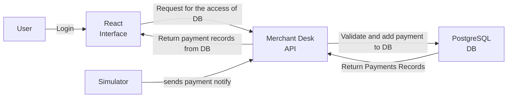

# Client Brief

The client initially asked for a place where they can track their payments and wouldn't get confused from duplicates. The system therefore has two concerns to satisfy this goal:

1. A **user-facing** payment tracker (the React Interface) that authenticates merchants and displays their payments with filtering so duplicates are easy to spot.
2. A **payment-ingestion** pipeline (Simulator -> Merchant Desk API -> PostgreSQL) that validates incoming payment notifications and stores them against the correct merchant before they are ever shown to the user.

Both concerns share the same underlying Merchant Desk API and PostgreSQL store, as shown in the architecture diagram below.

## Tech Stack

TypeScript, Fastify API, PostgreSQL, React.

- **TypeScript** - language for both the frontend and backend.
- **Fastify API** - framework for the Merchant Desk API.
- **PostgreSQL** - persistent store for merchant identities and payment records.
- **React** - library for the React Interface the user signs into.

## Architecture Diagram

The five components referenced throughout this brief are User, React Interface, Merchant Desk API, PostgreSQL DB, and Simulator.

## User View Flow

This flow covers the path of the User through the React Interface and back. It corresponds to the top and bottom edges of the diagram (left-to-right: User -> React Interface -> Merchant Desk API -> PostgreSQL -> return).

1. **Login** - User signs in to the React Interface.
2. **Authenticate** - the React Interface requests DB access from the Merchant Desk API; the API authenticates the merchant.
3. **View payments** - the Merchant Desk API reads the merchant's payment records from PostgreSQL and returns them to the React Interface, which shows the list with a filter system.
4. **Logout** - User logs out from the React Interface.

## Payment Event Flow

This flow covers the background ingestion of payment notifications. It corresponds to the middle section of the diagram (Simulator -> Merchant Desk API -> PostgreSQL).

1. **Notification created** - the Simulator builds a sample payment notification addressed to the merchant.
2. **Notification sent** - the Simulator sends the notification to the Merchant Desk API.
3. **Validate and store** - the Merchant Desk API validates the incoming notification; if it is valid, the API stores the payment into the appropriate merchant's table in PostgreSQL; otherwise the notification is rejected.
